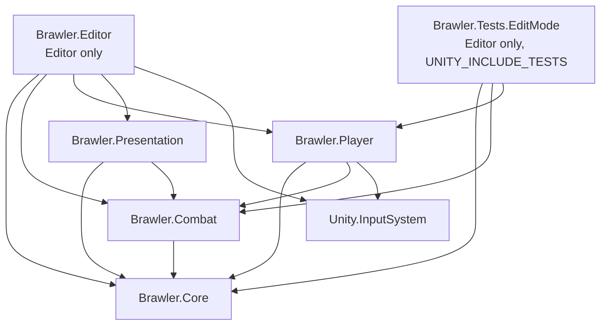
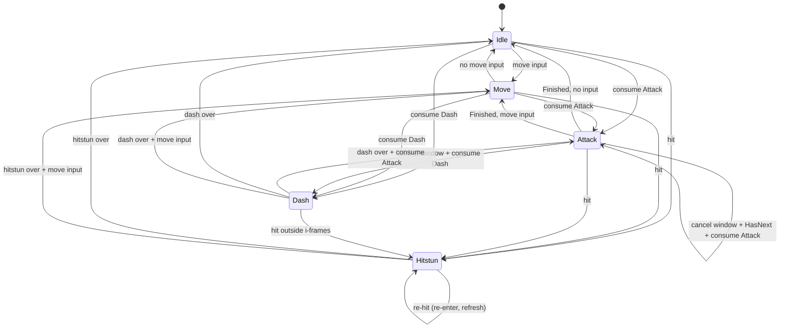

# Historical architecture archive

This is the original Day One scaffold specification, not a description of the current implementation.
Keep it for historical reference; current behavior and setup are documented in README.md and the source.

---

## 1. Overview & module boundaries

All code lives under `Assets/_MyFiles/`. One assembly per module; each asmdef sits in its module folder.

| Assembly | Namespace | Folder | References | Responsibility |
|---|---|---|---|---|
| `Brawler.Core` | `Brawler.Core` | `Scripts/Core` | — | Engine-light primitives: state machine, event bus (+ SO handle), input buffer, frame time/clock, facing interface. No gameplay concepts. |
| `Brawler.Combat` | `Brawler.Combat` | `Scripts/Combat` | Core | Damage contracts, attack/combo data, frame data & combo windows, hitbox/hurtbox queries, `HitEvent`, training dummy. Shared by player and (future) enemies. |
| `Brawler.Player` | `Brawler.Player` | `Scripts/Player` | Core, Combat, `Unity.InputSystem` | Input reading, player controller, player context & states, movement settings. |
| `Brawler.Presentation` | `Brawler.Presentation` | `Scripts/Presentation` | Core, Combat | Billboards, blob shadow, camera rig, feedback listeners (hitstop, shake, damage numbers). **Never references Player.** |
| `Brawler.Editor` | `Brawler.Editor` | `Scripts/Editor` | Core, Combat, Player, Presentation, `Unity.InputSystem` | Editor-only tooling: `TestSceneBuilder` (creates SO assets, prefab, placeholder art, scene). |
| `Brawler.Tests.EditMode` | `Brawler.Tests` | `Tests/EditMode` | Core, Combat, Player, `UnityEngine.TestRunner`, `UnityEditor.TestRunner`, nunit | EditMode tests (the spec; expected to fail until the TODOs are filled in). |

Other folders: `Data/{Core,Combat,Player,Presentation,Input}` (assets), `Art/{Shaders,Materials,Sprites,Prefabs}`, `Scenes/`.

The pre-existing `Scripts/Player/PlayerScript.cs` (early placeholder, global namespace) will compile into `Brawler.Player` once the asmdef exists. Leave it alone.

### 1.1 Assembly dependency graph



Player ↔ Presentation have **no** reference either way. They communicate only through Core (`IFacingSource`, `IEventBus`) and Combat (`HitEvent`, `DamageInfo`).

### 1.2 Exact asmdef files (created by Core Systems agent)

All use name references (Unity resolves by assembly name). `autoReferenced: true` for runtime assemblies, `false` for Editor/Tests.

`Scripts/Core/Brawler.Core.asmdef`
```json
{ "name": "Brawler.Core", "rootNamespace": "Brawler.Core", "references": [], "includePlatforms": [], "excludePlatforms": [],
  "allowUnsafeCode": false, "overrideReferences": false, "precompiledReferences": [], "autoReferenced": true,
  "defineConstraints": [], "versionDefines": [], "noEngineReferences": false }
```
`Scripts/Combat/Brawler.Combat.asmdef` — same shape, `"name": "Brawler.Combat"`, `"rootNamespace": "Brawler.Combat"`, `"references": ["Brawler.Core"]`.

`Scripts/Player/Brawler.Player.asmdef` — `"references": ["Brawler.Core", "Brawler.Combat", "Unity.InputSystem"]`.

`Scripts/Presentation/Brawler.Presentation.asmdef` — `"references": ["Brawler.Core", "Brawler.Combat"]`.

`Scripts/Editor/Brawler.Editor.asmdef`
```json
{ "name": "Brawler.Editor", "rootNamespace": "Brawler.Editor",
  "references": ["Brawler.Core", "Brawler.Combat", "Brawler.Player", "Brawler.Presentation", "Unity.InputSystem"],
  "includePlatforms": ["Editor"], "excludePlatforms": [], "allowUnsafeCode": false, "overrideReferences": false,
  "precompiledReferences": [], "autoReferenced": false, "defineConstraints": [], "versionDefines": [], "noEngineReferences": false }
```
`Tests/EditMode/Brawler.Tests.EditMode.asmdef`
```json
{ "name": "Brawler.Tests.EditMode", "rootNamespace": "Brawler.Tests",
  "references": ["Brawler.Core", "Brawler.Combat", "Brawler.Player", "UnityEngine.TestRunner", "UnityEditor.TestRunner"],
  "includePlatforms": ["Editor"], "excludePlatforms": [], "allowUnsafeCode": false, "overrideReferences": true,
  "precompiledReferences": ["nunit.framework.dll"], "autoReferenced": false,
  "defineConstraints": ["UNITY_INCLUDE_TESTS"], "versionDefines": [], "noEngineReferences": false }
```

---

## 2. Interfaces & data contracts

Files marked **(A)** already exist (created by the Architect). Everything else is specified here and created by the owner in §8.

### 2.1 Core (`Brawler.Core`)

```csharp
// (A) IState.cs
public interface IState<in TContext> {
    void Enter(TContext context);
    void Tick(TContext context, float deltaTime);          // Update
    void FixedTick(TContext context, float fixedDeltaTime); // FixedUpdate
    void Exit(TContext context);
}

// (A) IEvent.cs — marker; implement on readonly structs only
public interface IEvent { }

// (A) IEventBus.cs
public interface IEventBus {
    void Subscribe<T>(Action<T> listener)   where T : struct, IEvent;
    void Unsubscribe<T>(Action<T> listener) where T : struct, IEvent;
    void Publish<T>(in T evt)               where T : struct, IEvent;
}

// (A) IFacingSource.cs
public interface IFacingSource { int FacingSign { get; } } // +1 right (+X), -1 left. Never 0.

// (A) BufferedCommand.cs
public enum BufferedCommand { None = 0, Attack = 1, Dash = 2 }

// (A) FrameTime.cs — implemented (pure conversion plumbing)
public static class FrameTime {
    public const int   FramesPerSecond = 60;
    public const float SecondsPerFrame = 1f / 60f;
    public static float ToSeconds(int frames);
    public static int   ToFrames(float seconds); // rounded
}

// (A) InputBufferSettings.cs — SO, see §6
// (A) EventBusAsset.cs — SO : IEventBus, forwards to an internal `new EventBus()`; OnDisable calls Clear(). Implemented.
```

**`StateMachine<TContext>`** (Core Systems) — `public sealed class`, pure C#.
```csharp
public StateMachine(TContext context);
public TContext Context { get; }
public IState<TContext> CurrentState { get; }   // null until first ChangeState
public IState<TContext> PreviousState { get; }
public void ChangeState(IState<TContext> next); // null ignored. Calls Current?.Exit, swaps, next.Enter.
                                                // SAME state re-enters (Exit then Enter) — HitstunState relies on this.
public void Tick(float deltaTime);              // Current?.Tick(Context, dt)
public void FixedTick(float fixedDeltaTime);    // Current?.FixedTick(Context, dt)
public bool IsInState(IState<TContext> state);  // reference equality
```
Edge case: ChangeState called from inside Enter/Exit — document chosen behavior (suggest: allowed; Enter of the latest state wins; PreviousState reflects the last swap).

**`EventBus`** (Core Systems) — `public sealed class EventBus : IEventBus`, pure C#.
```csharp
public EventBus();
public void Clear();                         // drop all listeners of all types
public int  GetListenerCount<T>() where T : struct, IEvent; // test hook
```
Storage: `Dictionary<Type, object>` holding `List<Action<T>>` (cast back, no boxing of T). Semantics (tested): subscription-order invocation; duplicate subscribe ignored; unsubscribe during publish → not invoked later in that publish (null the slot, compact when publish depth returns to 0); subscribe during publish → invoked next publish; listener exception → `Debug.LogException`, continue; publish with no listeners → no-op, no allocation.

**`InputBuffer`** (Core Systems) — `public sealed class InputBuffer`, pure C#, fixed ring buffer.
```csharp
public InputBuffer(float windowSeconds, int capacity);  // capacity < 1 is CLAMPED to 1 (implemented in the ctor); the array is allocated here only
public float WindowSeconds { get; set; }
public int   Capacity { get; }
public int   Count { get; }                               // stored entries (may include expired until pruned)
public void  Enqueue(BufferedCommand command, float time); // None ignored; full → overwrite oldest
public bool  TryConsume(BufferedCommand command, float now); // removes OLDEST live matching entry
public bool  Peek(BufferedCommand command, float now);       // live matching entry exists, no removal
public void  Clear();
```
"Live" = `now - time <= WindowSeconds` (inclusive); entries stamped in the future (`time > now`) count as live. Other commands are untouched by a TryConsume. Entry type is a private struct (command + timestamp).

**`FrameClock`** (Core Systems) — `public sealed class FrameClock`, pure C#. Converts any delta into whole 60 Hz frames so frame data is correct regardless of `Time.fixedDeltaTime`.
```csharp
public int  Frame { get; }               // 0 after Reset
public int  Advance(float deltaSeconds); // accumulate; for each whole SecondsPerFrame: Frame++. Returns frames stepped (0..n). Negative/zero dt → 0.
public void Reset();                     // Frame = 0, accumulator = 0
```
Usage contract: on state Enter → `Reset()` and process frame 0; each FixedTick → `steps = Advance(dt)`, then process each newly entered frame `Frame-steps+1 .. Frame` (so 1-frame active windows are never skipped).

### 2.2 Combat (`Brawler.Combat`)

```csharp
// (A) IDamageable.cs
public interface IDamageable { bool TryApplyDamage(in DamageInfo info); } // true = connected

// (A) IKnockbackable.cs
public interface IKnockbackable { void ApplyKnockback(Vector3 velocity); } // SETS knockback velocity (units/s)

// (A) IInvulnerable.cs
public interface IInvulnerable { bool IsInvulnerable { get; } }

// (A) DamageInfo.cs
public readonly struct DamageInfo {
    public readonly int Amount; public readonly Vector3 Knockback; public readonly int HitstunFrames;
    public readonly Vector3 HitPoint; public readonly Transform Source;
    public DamageInfo(int amount, Vector3 knockback, int hitstunFrames, Vector3 hitPoint, Transform source);
}

// (A) AttackPhase.cs
public enum AttackPhase { Startup = 0, Active = 1, Recovery = 2, Finished = 3 }

// (A) AttackFrames.cs — [Serializable] struct, pure queries (TODO bodies, tested)
public AttackFrames(int startup, int active, int recovery, int cancelWindowStart, int cancelWindowEnd);
public int Startup, Active, Recovery, CancelWindowStart, CancelWindowEnd, TotalFrames { get; }
public AttackPhase GetPhase(int frame);   // [0,S) Startup, [S,S+A) Active, [S+A,Total) Recovery, >=Total Finished; frame<0 → Startup
public bool IsActive(int frame);
public bool IsInCancelWindow(int frame);  // [start, end); start >= end → never
public bool IsFinished(int frame);        // frame >= TotalFrames

// (A) AttackData.cs — SO, see §6. Plus:
public DamageInfo CreateDamageInfo(int facingSign, Vector3 hitPoint, Transform source); // TODO body
// (A) ComboData.cs — SO: int Count; AttackData GetAttack(int index) (null if out of range; implemented)
// (A) CombatSettings.cs, TrainingDummySettings.cs — SOs, see §6
// (A) HitEvent.cs — see §3
```

**`ComboTracker`** (Player & Combat) — `public sealed class ComboTracker`, pure C#, knows only indices (testable without assets).
```csharp
public ComboTracker(int comboLength);   // length >= 0
public int  ComboLength { get; }
public int  CurrentIndex { get; }       // -1 when not in a combo
public bool IsInCombo { get; }          // CurrentIndex >= 0
public bool HasNext { get; }            // IsInCombo && CurrentIndex + 1 < ComboLength
public bool IsFinisher { get; }         // IsInCombo && CurrentIndex == ComboLength - 1
public int  Begin();                    // CurrentIndex = 0 (restarts if already in combo); returns 0; returns -1 if length 0
public bool TryAdvance(out int nextIndex); // if HasNext: ++CurrentIndex, true. Else false, nextIndex = CurrentIndex, no change.
public void Reset();                    // CurrentIndex = -1
```

**`Hurtbox`** (Player & Combat) — MonoBehaviour on a child with a **trigger** collider.
```csharp
public IDamageable    Damageable    { get; } // resolved from _owner in Awake (cast)
public IKnockbackable Knockbackable { get; } // may be null
public bool           IsInvulnerable { get; } // _owner as IInvulnerable?.IsInvulnerable ?? false
public Transform      OwnerRoot { get; }      // _owner.transform
public Collider       Collider { get; }
```
`OnValidate`: warn if `_owner` doesn't implement `IDamageable`.

**`Hitbox`** (Player & Combat) — MonoBehaviour; its transform is the hitbox origin (child at the attacker's feet).
```csharp
public bool IsActive { get; }
public void BeginAttack(AttackData attack, int facingSign); // store attack/facing, clear per-activation hit set
public int  Sweep();     // one overlap query for the current frame; returns NEW hits this call
public void EndAttack(); // clear state
public Vector3 GetWorldCenter(); // origin + (offset.x * facing, offset.y, 0)
public Vector3 GetHalfExtents(); // (size.x/2, size.y/2, CombatSettings.DepthTolerance)
```
Sweep algorithm (TODO): `Physics.OverlapBoxNonAlloc(center, halfExtents, _results, Quaternion.identity, settings.HurtboxLayers, QueryTriggerInteraction.Collide)` → for each: `TryGetComponent<Hurtbox>` (skip null) → skip `_ownerHurtbox` → skip already-hit this activation → **skip `IsInvulnerable` WITHOUT marking as hit** → `info = attack.CreateDamageInfo(facing, hurtbox.Collider.ClosestPoint(center), _owner)` → `if (Damageable.TryApplyDamage(in info))` { `Knockbackable?.ApplyKnockback(info.Knockback)`; mark hit; `_eventBus.Publish(new HitEvent(info, hurtbox.OwnerRoot, attack.HitStopFrames, attack.ScreenShake))` }. Buffers (`Collider[]` sized `MaxOverlapResults`, `HashSet<Hurtbox>` or fixed array) allocated in `Awake`. `OnDrawGizmos` draws the box when `_drawGizmos`.

**`TrainingDummy`** (Player & Combat) — MonoBehaviour : `IDamageable`, `IKnockbackable`. Never dies.
```csharp
public int CurrentHealth { get; }
public int MaxHealth { get; }
public bool TryApplyDamage(in DamageInfo info);  // subtract (clamp 0), restart reset timer, true
public void ApplyKnockback(Vector3 velocity);   // velocity * settings.KnockbackScale
```
Update: decelerate knockback, apply gravity, `CharacterController.Move`; reset health after `ResetDelaySeconds` without hits.

### 2.3 Player (`Brawler.Player`)

**`PlayerInputReader`** (Player & Combat) — MonoBehaviour. Input System via `InputActionReference` (no generated class, no string lookups).
Decorated with `[DefaultExecutionOrder(PlayerInputReader.ExecutionOrder)]` so its `Update` samples input before `PlayerController.Update` (default order 0). Execution order is set in code only — no tooling mutates `.meta` files / `MonoImporter`.
```csharp
public const int ExecutionOrder = -50;                    // runs before PlayerController
public Vector2 Move { get; }                              // raw stick/WASD, read in Update
public event Action<BufferedCommand> CommandPressed;      // raised from action.performed
```
OnEnable: enable actions, subscribe cached `Action<InputAction.CallbackContext>` delegates. OnDisable: reverse.

**`PlayerContext`** (Player & Combat) — `public sealed class`, shared by states. Constructor-injected; no MonoBehaviour.
```csharp
public PlayerContext(PlayerController owner, CharacterController controller, PlayerInputReader input,
                     InputBuffer buffer, PlayerMovementSettings movement, ComboData combo, Hitbox hitbox);
// ctor (wiring, implemented): stores refs, ComboTracker = new ComboTracker(combo?.Count ?? 0), FacingSign = 1 (IFacingSource: never 0)
// Services
public PlayerController       Owner { get; }
public CharacterController    Controller { get; }
public PlayerInputReader      Input { get; }
public InputBuffer            Buffer { get; }
public PlayerMovementSettings Movement { get; }
public ComboData              Combo { get; }
public ComboTracker           ComboTracker { get; }  // new ComboTracker(combo.Count)
public Hitbox                 Hitbox { get; }
public PlayerStates           States { get; set; }   // set once by PlayerController after construction
public StateMachine<PlayerContext> Machine { get; set; }
// Mutable runtime data
public float      Time { get; set; }            // Time.time, written by PlayerController before Tick/FixedTick
public Vector3    Velocity { get; set; }        // planar (X/Z) velocity; Y handled by gravity in the motor step
public int        FacingSign { get; set; }      // +1/-1
public bool       IsInvulnerable { get; set; }  // DashState writes per frame
public DamageInfo LastHit { get; set; }         // HitstunState reads on Enter
// Helpers (TODO bodies)
public Vector3 GetMoveInputWorld();             // (x, 0, y * DepthSpeedMultiplier) with deadzone applied; zero if neutral
public bool    HasMoveInput();
public void    Move(Vector3 planarVelocity, float deltaTime); // CC.Move with gravity
```

**`PlayerStates`** (Player & Combat) — `public sealed class` holding one instance of each state:
`public IdleState Idle { get; }`, `MoveState Move { get; }`, `AttackState Attack { get; }`, `DashState Dash { get; }`, `HitstunState Hitstun { get; }`; ctor `PlayerStates()` news them up.

**States** (Player & Combat) — `public sealed class XState : IState<PlayerContext>`: `IdleState`, `MoveState`, `AttackState`, `DashState`, `HitstunState`. Attack/Dash/Hitstun each own a private `FrameClock`.

**`PlayerController`** (Player & Combat) — MonoBehaviour : `IFacingSource`, `IDamageable`, `IKnockbackable`, `IInvulnerable`.
```csharp
public int  FacingSign { get; }       // context.FacingSign
public bool IsInvulnerable { get; }   // context.IsInvulnerable
public IState<PlayerContext> CurrentState { get; } // debugging/gizmos
public bool TryApplyDamage(in DamageInfo info);    // if invulnerable → false; else LastHit = info; Machine.ChangeState(States.Hitstun); true
public void ApplyKnockback(Vector3 velocity);      // context.Velocity = planar part (X/Z)
```
Awake: build `InputBuffer(settings.BufferWindowSeconds, settings.Capacity)`, `PlayerContext`, `PlayerStates`, `StateMachine`, `ChangeState(Idle)`. OnEnable/OnDisable: subscribe `_inputReader.CommandPressed` → `Buffer.Enqueue(cmd, Time.time)`. Update: `context.Time = Time.time; Machine.Tick(Time.deltaTime)`. FixedUpdate: `context.Time = Time.time; Machine.FixedTick(Time.fixedDeltaTime)`.

### 2.4 Presentation (`Brawler.Presentation`)

Script execution order (LateUpdate chain): `CameraRig` declares `public const int ExecutionOrder = 100` and `BillboardSprite` declares `public const int ExecutionOrder = CameraRig.ExecutionOrder + 10`, both applied via `[DefaultExecutionOrder(ExecutionOrder)]`, so billboards always read the camera's final rotation for the frame. (`PlayerInputReader.ExecutionOrder = -50`, §2.3, is the only other non-default order.)

| Class | Public surface |
|---|---|
| `BillboardSprite` | `LateUpdate`: rotation = camera rotation (or yaw-only when `_matchCameraPitch` false); `SpriteRenderer.flipX = facing < 0` if a facing source is wired. |
| `BlobShadow` | `LateUpdate`: `Physics.Raycast` down (QueryTriggerInteraction.Ignore) from `transform.position + up*0.1`; place `_shadowTransform` at hit + `_groundOffset`, scale by height (lerp `_baseScale` → `_baseScale * _minScaleAtMaxDistance`); hide if no hit. |
| `CameraRig` | `public void SnapToTarget()`; `LateUpdate` SmoothDamp rig position to `target + TargetOffset`; `ApplySettings()` sets pivot rotation (pitch, yaw), camera local position `(0,0,-Distance)`, FOV. Called in Awake and OnValidate. |
| `ScreenShake` | `public void AddTrauma(float amount)` (clamp 0..1). Listens to `HitEvent` → `AddTrauma(evt.ScreenShake)`. LateUpdate (unscaled): offset = Perlin * trauma² * MaxOffset on `_shakeTransform.localPosition` (X/Y only); decay. |
| `HitStop` | `public bool IsActive { get; }`, `public void Trigger(float seconds)`. Listens to `HitEvent` → `Trigger(FrameTime.ToSeconds(evt.HitStopFrames))`. Sets `Time.timeScale = HitStopTimeScale`; remaining = max(remaining, min(seconds, MaxHitStopSeconds)); counts down with `Time.unscaledDeltaTime`; restores the timeScale captured at first trigger. OnDisable restores. |
| `DamageNumberSpawner` | `public void Spawn(int amount, Vector3 worldPosition)`. Listens to `HitEvent` → `Spawn(evt.Damage.Amount, evt.Damage.HitPoint)`. Owns `ObjectPool<DamageNumber>` (`UnityEngine.Pool`), create/get/release/destroy as cached method groups. |
| `DamageNumber` | `public void Initialize(IObjectPool<DamageNumber> pool, FeedbackSettings settings)` (once, on create); `public void Play(int amount, Vector3 position, Quaternion rotation)`; Update (unscaled): rise + fade, then `pool.Release(this)` exactly once. Uses legacy `TextMesh` (no TMP essentials dependency; WebGL-safe). |

All listeners subscribe in `OnEnable` / unsubscribe in `OnDisable` with a cached `Action<HitEvent>` field.

---

## 3. Event list

Only one event on Day One. Add new events as `readonly struct : IEvent` in the publishing module (via the contract change process).

| Struct | Assembly | Fields | Publisher | Subscribers |
|---|---|---|---|---|
| `HitEvent` | Combat | `DamageInfo Damage`, `Transform Target`, `int HitStopFrames`, `float ScreenShake`; ctor `(in DamageInfo, Transform, int, float)` | `Hitbox.Sweep` (once per connected target per activation, after damage+knockback) | `HitStop` (freeze), `ScreenShake` (trauma), `DamageNumberSpawner` (number at `Damage.HitPoint`) |

Not events on purpose: state changes (Presentation cannot see Player; add a Core-level event later if sprites need animation hooks), damage-rejected/whiffs (nothing listens yet).

---

## 4. Player state machine



### 4.1 Transition table

Priority: lower number wins when several conditions are true in the same check. "consume X" = `Buffer.TryConsume(X, ctx.Time)`; check in priority order and stop at the first success so only one command is consumed. Voluntary transitions are evaluated in **Tick** (except Attack/Dash/Hitstun end-of-timeline checks which happen in FixedTick right after the frame advances).

| From | To | Condition / trigger | Priority |
|---|---|---|---|
| Any (not invulnerable) | Hitstun | `PlayerController.TryApplyDamage` (external, from an enemy `Hitbox.Sweep`) → `ChangeState(Hitstun)` immediately | 0 (interrupt) |
| Dash (during i-frames) | — | Hit is skipped by `Hitbox` (hurtbox `IsInvulnerable`); no state change, target not marked hit | 0 |
| Hitstun | Hitstun | Re-hit: same-state re-entry, frame clock reset with new `LastHit.HitstunFrames` | 0 |
| Idle / Move | Dash | consume Dash | 1 |
| Idle / Move | Attack | consume Attack → `ComboTracker.Begin()` | 2 |
| Idle | Move | `HasMoveInput()` | 3 |
| Move | Idle | `!HasMoveInput()` | 3 |
| Attack | Dash | `Frames.IsInCancelWindow(frame)` && consume Dash → `ComboTracker.Reset()` | 1 |
| Attack | Attack (next) | `IsInCancelWindow(frame)` && `ComboTracker.HasNext` && consume Attack → `TryAdvance`, re-enter | 2 |
| Attack | Move / Idle | `Frames.IsFinished(frame)` → `ComboTracker.Reset()`; Move if input else Idle | 3 |
| Dash | Attack | `frame >= DashFrames` && consume Attack (dash-attack buffering) | 1 |
| Dash | Move / Idle | `frame >= DashFrames` | 2 |
| Hitstun | Move / Idle | `frame >= LastHit.HitstunFrames` | 1 |

Rules:
- **I-frames:** `DashState` sets `ctx.IsInvulnerable = DashIFrameStart <= frame < DashIFrameEnd` each processed frame; clears it on Exit (always — an interrupted dash must never leave the player invulnerable).
- **Cancel windows** come only from `AttackFrames` of the current attack. Inputs pressed before the window opens stay buffered for `BufferWindowSeconds` (scaled time, so they survive hitstop). The finisher has no `HasNext`, so its window is dash-cancel only.
- **Combo reset (no timeout):** the chain resets when the current attack's recovery finishes (`IsFinished` → `ComboTracker.Reset()`), on dash-cancel, or on hitstun. There is deliberately no time-based combo timeout on Day One — see §10.2.
- **Facing** changes only in Idle/Move (and at Dash start) from non-zero input X. Locked during Attack and Hitstun.
- **Hitstun Enter:** `Buffer.Clear()` (no mashing out), `Hitbox.EndAttack()`, `ComboTracker.Reset()`. Velocity comes from `ApplyKnockback`, which Hitbox calls *after* `TryApplyDamage` — so Hitstun.Enter must not zero velocity after that (zero it in Enter, knockback overwrites right after).
- **Attack Enter:** `attack = Combo.GetAttack(ComboTracker.CurrentIndex)`, `clock.Reset()`, `Hitbox.BeginAttack(attack, FacingSign)`. Each processed frame: if `IsActive(frame)` → `Hitbox.Sweep()`. Exit → `Hitbox.EndAttack()`. Lunge `attack.LungeSpeed * facing` on X during Startup+Active.

---

## 5. Timing model

- **Frame data** (attacks, dash, hitstun, hitstop) is authored in **60 Hz frames**. `FrameTime` converts; `FrameClock` turns accumulated scaled fixed-delta seconds into whole frames, so correctness does **not** depend on `Time.fixedDeltaTime`. Recommended (optional): Project Settings → Time → Fixed Timestep = `0.0166667` so one FixedUpdate ≈ one frame.
- **Tick (Update, `Time.deltaTime`)**: read input, evaluate voluntary transitions, compute velocity, `CharacterController.Move`. Movement stays in Update because CharacterController has no interpolation — moving it in FixedUpdate stutters at high refresh rates.
- **FixedTick (FixedUpdate, `Time.fixedDeltaTime`)**: advance `FrameClock`s, hitbox sweeps on active frames, i-frame flag, hitstun/dash/attack end checks. Note: hurtbox colliders moved in Update are synced by physics before the next simulation step; queries may be ≤1 step stale, acceptable for Day One (if it matters, call `Physics.SyncTransforms()` once before sweeps).
- **Hitstop** = global `Time.timeScale = HitStopTimeScale` (default 0) for `ToSeconds(HitStopFrames)` real seconds. At timeScale 0, FixedUpdate does not run and `Time.deltaTime` is 0 → all frame timelines, movement and knockback freeze automatically. Hitstop, ScreenShake and DamageNumber animation use **unscaled** time; CameraRig follow uses scaled time (target is frozen anyway). The InputBuffer uses `Time.time` (scaled) → presses during hitstop stay fresh until play resumes (classic hitstop buffering).
- Overlapping hitstops: remaining = max(remaining, new), capped by `MaxHitStopSeconds`. HitStop always restores the timeScale it captured on first trigger (and on OnDisable).

## 6. WebGL / performance notes

- No threads/Tasks; everything on the main thread.
- No per-frame allocations: `OverlapBoxNonAlloc` with preallocated `Collider[]`; `TryGetComponent` (non-allocating); `InputBuffer` fixed ring; cached delegates for event and input subscriptions; no LINQ, no lambdas/closures in Tick paths; events are `readonly struct` published by `in` reference and never boxed (`T : struct` constraint).
- Single shared opaque alpha-clip material for all sprites (SRP Batcher friendly, ZWrite on → correct depth sorting between billboards without transparency sorting issues).
- Damage numbers: legacy `TextMesh` (avoids TMP essentials import); pooled.
- Use `Debug.Log` only in TODO guidance/warnings, not every frame.

### Pooling approach
Use `UnityEngine.Pool.ObjectPool<T>` / `IObjectPool<T>`. Owner (e.g. `DamageNumberSpawner`) creates the pool in Awake with `collectionCheck: true` in editor (`Application.isEditor`), `defaultCapacity` / `maxSize` from `FeedbackSettings`. Pooled object receives its `IObjectPool<T>` once on create and releases itself exactly once when done (guard flag). `actionOnGet` → `SetActive(true)`, `actionOnRelease` → `SetActive(false)`, `actionOnDestroy` → `Destroy(go)`. Pools are disposed (`Clear()`) in OnDestroy. Future VFX/hit sparks follow the same pattern.

---

## 7. Inspector wiring (FINAL field names)

These names are the `SerializedObject` contract for `TestSceneBuilder`. All are `[SerializeField] private`, with `[Tooltip]` and `[Header]`. Nested struct fields use `parent.child` property paths.

### 7.1 ScriptableObjects

| Class | Assembly | File | Fields (`name : type = default`) |
|---|---|---|---|
| `EventBusAsset` (A) | Core | `Scripts/Core/EventBusAsset.cs` | *(none)* |
| `InputBufferSettings` (A) | Core | `Scripts/Core/InputBufferSettings.cs` | `_bufferWindowSeconds : float = 0.2`, `_capacity : int = 8` |
| `AttackData` (A) | Combat | `Scripts/Combat/AttackData.cs` | `_damage : int = 10`, `_knockback : Vector2 = (3,0)`, `_hitstunFrames : int = 16`, `_frames : AttackFrames` → `_frames._startup`, `_frames._active`, `_frames._recovery`, `_frames._cancelWindowStart`, `_frames._cancelWindowEnd` (ints), `_hitboxSize : Vector2 = (1.2,0.8)`, `_hitboxOffset : Vector2 = (0.75,1)`, `_lungeSpeed : float = 1.5`, `_hitStopFrames : int = 4`, `_screenShake : float = 0.15` |
| `ComboData` (A) | Combat | `Scripts/Combat/ComboData.cs` | `_attacks : AttackData[]` |
| `CombatSettings` (A) | Combat | `Scripts/Combat/CombatSettings.cs` | `_hurtboxLayers : LayerMask = Everything`, `_maxOverlapResults : int = 16`, `_depthTolerance : float = 0.35` |
| `TrainingDummySettings` (A) | Combat | `Scripts/Combat/TrainingDummySettings.cs` | `_maxHealth : int = 100`, `_resetDelaySeconds : float = 2`, `_knockbackScale : float = 1`, `_knockbackDeceleration : float = 25`, `_gravity : float = -30` |
| `PlayerMovementSettings` (A) | Player | `Scripts/Player/PlayerMovementSettings.cs` | `_moveSpeed : float = 6`, `_depthSpeedMultiplier : float = 0.75`, `_acceleration : float = 80`, `_deceleration : float = 100`, `_inputDeadzone : float = 0.15`, `_gravity : float = -30`, `_dashSpeed : float = 16`, `_dashFrames : int = 12`, `_dashIFrameStart : int = 0`, `_dashIFrameEnd : int = 8`, `_knockbackDeceleration : float = 30` |
| `FeedbackSettings` (A) | Presentation | `Scripts/Presentation/FeedbackSettings.cs` | `_hitStopTimeScale : float = 0`, `_maxHitStopSeconds : float = 0.25`, `_shakeMaxOffset : float = 0.3`, `_shakeFrequency : float = 25`, `_traumaDecayPerSecond : float = 2`, `_damageNumberLifetime : float = 0.7`, `_damageNumberRise : float = 1.2`, `_damageNumberSpawnOffset : Vector3 = (0,0.5,0)`, `_damageNumberSpread : float = 0.25`, `_damageNumberPoolCapacity : int = 16`, `_damageNumberPoolMaxSize : int = 64` |
| `CameraRigSettings` (A) | Presentation | `Scripts/Presentation/CameraRigSettings.cs` | `_pitch : float = 25`, `_yaw : float = 0`, `_distance : float = 14`, `_fieldOfView : float = 30`, `_targetOffset : Vector3 = (0,1,0)`, `_followSmoothTime : float = 0.12` |

### 7.2 MonoBehaviours

| Class | Assembly | File | Fields (`name : type`) |
|---|---|---|---|
| `Hitbox` | Combat | `Scripts/Combat/Hitbox.cs` | `_combatSettings : CombatSettings`, `_eventBus : EventBusAsset`, `_owner : Transform` (attacker root, DamageInfo.Source), `_ownerHurtbox : Hurtbox` (skipped), `_drawGizmos : bool = true` |
| `Hurtbox` | Combat | `Scripts/Combat/Hurtbox.cs` | `_collider : Collider` (trigger), `_owner : MonoBehaviour` (must implement IDamageable; optionally IKnockbackable / IInvulnerable) |
| `TrainingDummy` | Combat | `Scripts/Combat/TrainingDummy.cs` | `_settings : TrainingDummySettings`, `_characterController : CharacterController` |
| `PlayerInputReader` | Player | `Scripts/Player/PlayerInputReader.cs` | `_moveAction : InputActionReference`, `_attackAction : InputActionReference`, `_dashAction : InputActionReference` |
| `PlayerController` | Player | `Scripts/Player/PlayerController.cs` | `_characterController : CharacterController`, `_inputReader : PlayerInputReader`, `_movementSettings : PlayerMovementSettings`, `_inputBufferSettings : InputBufferSettings`, `_comboData : ComboData`, `_hitbox : Hitbox` |
| `BillboardSprite` | Presentation | `Scripts/Presentation/BillboardSprite.cs` | `_cameraTransform : Transform`, `_spriteRenderer : SpriteRenderer`, `_facingSource : MonoBehaviour` (optional, must implement IFacingSource), `_matchCameraPitch : bool = true` |
| `BlobShadow` | Presentation | `Scripts/Presentation/BlobShadow.cs` | `_shadowTransform : Transform`, `_groundLayers : LayerMask = Everything`, `_maxDistance : float = 5`, `_baseScale : float = 1`, `_minScaleAtMaxDistance : float = 0.4`, `_groundOffset : float = 0.01` |
| `CameraRig` | Presentation | `Scripts/Presentation/CameraRig.cs` | `_target : Transform`, `_settings : CameraRigSettings`, `_pivot : Transform`, `_camera : Camera` |
| `ScreenShake` | Presentation | `Scripts/Presentation/ScreenShake.cs` | `_eventBus : EventBusAsset`, `_settings : FeedbackSettings`, `_shakeTransform : Transform` |
| `HitStop` | Presentation | `Scripts/Presentation/HitStop.cs` | `_eventBus : EventBusAsset`, `_settings : FeedbackSettings` |
| `DamageNumberSpawner` | Presentation | `Scripts/Presentation/DamageNumberSpawner.cs` | `_eventBus : EventBusAsset`, `_settings : FeedbackSettings`, `_prefab : DamageNumber`, `_cameraTransform : Transform` |
| `DamageNumber` | Presentation | `Scripts/Presentation/DamageNumber.cs` | `_text : TextMesh` |

Interface-typed references are serialized as `MonoBehaviour` and cast in `Awake` (Unity can't serialize interfaces); validate in `OnValidate`.

### 7.3 Asset paths (all under `Assets/_MyFiles/`)

| Path | Type | Created by |
|---|---|---|
| `Data/Input/BrawlerControls.inputactions` | Input Actions, map `Gameplay`: `Move` (Value/Vector2: WASD + arrows 2DVector composite, `<Gamepad>/leftStick`), `Attack` (Button: `<Keyboard>/j`, `<Mouse>/leftButton`, `<Gamepad>/buttonWest`), `Dash` (Button: `<Keyboard>/k`, `<Keyboard>/space`, `<Gamepad>/buttonSouth`). Control schemes `Keyboard&Mouse`, `Gamepad`. | Core Systems (hand-authored JSON) |
| `Data/Core/EventBus.asset` | EventBusAsset | Presentation (scene builder) |
| `Data/Core/InputBufferSettings.asset` | InputBufferSettings | Presentation (scene builder) |
| `Data/Combat/CombatSettings.asset` | CombatSettings | Presentation (scene builder) |
| `Data/Combat/TrainingDummySettings.asset` | TrainingDummySettings | Presentation (scene builder) |
| `Data/Player/PlayerMovementSettings.asset` | PlayerMovementSettings | Presentation (scene builder) |
| `Data/Player/Attack_Jab1.asset`, `Attack_Jab2.asset`, `Attack_Finisher.asset` | AttackData (values §7.4) | Presentation (scene builder) |
| `Data/Player/Combo_Basic.asset` | ComboData `[Jab1, Jab2, Finisher]` | Presentation (scene builder) |
| `Data/Presentation/FeedbackSettings.asset`, `CameraRigSettings.asset` | SOs | Presentation (scene builder) |
| `Art/Shaders/SpriteAlphaClip.shader` | `Brawler/SpriteAlphaClip` | Presentation |
| `Art/Shaders/BlobShadow.shader` | `Brawler/BlobShadow` (unlit, transparent, procedural radial falloff from UV — no texture) | Presentation |
| `Art/Materials/M_SpriteAlphaClip.mat`, `M_BlobShadow.mat`, `M_Ground.mat` (URP Lit), `M_Prop.mat` (URP Lit, arena crates/pillar) | Materials | Presentation (scene builder) |
| `Art/Sprites/T_Player_Placeholder.png`, `T_Dummy_Placeholder.png` | Sprites (pivot bottom-center, PPU 32, point filter), generated by builder | Presentation |
| `Art/Prefabs/P_DamageNumber.prefab` | DamageNumber + TextMesh | Presentation (scene builder) |
| `Scenes/TestArena.unity` | Test scene | Presentation (scene builder) |

Scene builder rule: the builder never edits `.meta` files or script execution order (that lives in `[DefaultExecutionOrder]` attributes). **create-if-missing** (never overwrite an existing asset that has been hand-tuned), SOs via `ScriptableObject.CreateInstance` + `AssetDatabase.CreateAsset`; property names centralised as `const string`s mirroring §7.

### 7.4 Starter attack values (builder writes these)

| Asset | dmg | knockback | hitstun | startup/active/recovery | cancel [start,end) | hitbox size / offset | lunge | hitstop | shake |
|---|---|---|---|---|---|---|---|---|---|
| Attack_Jab1 | 8 | (2, 0) | 14 | 4 / 3 / 10 | [7, 17) | (1.1, 0.8) / (0.7, 1.0) | 1.5 | 3 | 0.10 |
| Attack_Jab2 | 10 | (2.5, 0) | 16 | 5 / 3 / 12 | [8, 20) | (1.2, 0.8) / (0.75, 1.0) | 2.0 | 4 | 0.15 |
| Attack_Finisher | 18 | (9, 2) | 28 | 8 / 4 / 22 | [20, 34) | (1.6, 1.2) / (0.9, 1.0) | 4.0 | 8 | 0.45 |

### 7.5 Scene hierarchy (TestArena)

```
Directional Light
Arena            (scaled cube/plane, M_Ground, BoxCollider; top at y=0; ~24 x 12)
CameraRig        [CameraRig]  → Pivot → ShakeRoot [ScreenShake._shakeTransform] → Main Camera (Camera, AudioListener, URP data)
Feedback         [HitStop] [ScreenShake] [DamageNumberSpawner]
Player           [CharacterController] [PlayerInputReader] [PlayerController]  at (0,0,0)
  ├ Visual       [SpriteRenderer M_SpriteAlphaClip] [BillboardSprite _facingSource=PlayerController]
  ├ Shadow       (quad, M_BlobShadow, rotated flat)   ← BlobShadow on Player root, _shadowTransform=Shadow
  ├ Hurtbox      [BoxCollider isTrigger] [Hurtbox _owner=PlayerController]
  └ Hitbox       [Hitbox _owner=Player, _ownerHurtbox=Player/Hurtbox]
Dummy_A / Dummy_B  [CharacterController] [TrainingDummy] [BlobShadow] at (3,0,0) and (5,0,1.5)
  ├ Visual / Shadow / Hurtbox [Hurtbox _owner=TrainingDummy]
```
`ScreenShake` component lives on `Feedback` (or ShakeRoot) — only its `_shakeTransform` must point at `ShakeRoot`.

---

## 8. Ownership (who writes which file)

No two agents write the same file. Folders already exist.

| Owner | Files |
|---|---|
| **Architect** (done) | `ARCHITECTURE.md`; Core: `IState.cs`, `IEvent.cs`, `IEventBus.cs`, `IFacingSource.cs`, `BufferedCommand.cs`, `FrameTime.cs`, `InputBufferSettings.cs`, `EventBusAsset.cs`; Combat: `IDamageable.cs`, `IKnockbackable.cs`, `IInvulnerable.cs`, `DamageInfo.cs`, `AttackPhase.cs`, `AttackFrames.cs`, `AttackData.cs`, `ComboData.cs`, `CombatSettings.cs`, `TrainingDummySettings.cs`, `HitEvent.cs`; Player: `PlayerMovementSettings.cs`; Presentation: `FeedbackSettings.cs`, `CameraRigSettings.cs` |
| **Core Systems** | All 6 `.asmdef` files (§1.2); `Scripts/Core/StateMachine.cs`, `EventBus.cs`, `InputBuffer.cs`, `FrameClock.cs`; `Tests/EditMode/StateMachineTests.cs`, `EventBusTests.cs`, `InputBufferTests.cs`, `FrameClockTests.cs`, `AttackFramesTests.cs`, `ComboTrackerTests.cs`; `Data/Input/BrawlerControls.inputactions` (tests use only the APIs in §2; construct `AttackFrames` via its ctor) |
| **Player & Combat** | `Scripts/Combat/ComboTracker.cs`, `Hitbox.cs`, `Hurtbox.cs`, `TrainingDummy.cs`; `Scripts/Player/PlayerInputReader.cs`, `PlayerController.cs`, `PlayerContext.cs`, `PlayerStates.cs`, `States/IdleState.cs`, `States/MoveState.cs`, `States/AttackState.cs`, `States/DashState.cs`, `States/HitstunState.cs` |
| **Presentation** | `Scripts/Presentation/BillboardSprite.cs`, `BlobShadow.cs`, `CameraRig.cs`, `ScreenShake.cs`, `HitStop.cs`, `DamageNumberSpawner.cs`, `DamageNumber.cs`; `Art/Shaders/*`, `Art/Materials/*` (+ `.meta` with fixed GUIDs only where cross-referenced); `Scripts/Editor/TestSceneBuilder.cs` (menu `Brawler/Build Test Scene`; also generates placeholder sprites, the damage-number prefab, all `.asset` instances in §7.3, and `Scenes/TestArena.unity`) |

`EventBusAsset` (Architect) calls `new EventBus()` and `EventBus.Clear()` — Core Systems must provide exactly those.

## 9. Contract change process

Everything in §2, §3, §7 and the asmdef graph is frozen for Day One. Parallel agents **must not** edit Architect-owned files or rename/retype any listed field, method, or asset path. If a contract is wrong or missing something, work around it locally where possible (private helpers inside your own files are fine) and **report the needed change in your final summary** (file, current contract, proposed change, why). The Architect/Reviewer applies it afterwards.

---

## 10. Conventions & known issues (Reviewer, Day One)

### 10.1 Scaffold warning pragma
Scaffold files whose private runtime fields are only touched by not-yet-written TODO bodies start with:
```csharp
// Scaffold: private fields are only read/written once the TODO bodies below are implemented.
// Remove this pragma when implementing.
#pragma warning disable CS0169, CS0649, CS0414
```
(`PlayerInputReader` also disables `CS0067` until `CommandPressed` is raised.) Applied to: Core `EventBus`, `FrameClock`, `InputBuffer`, `StateMachine`; Combat `Hitbox`, `TrainingDummy`; Player `PlayerContext`, `PlayerInputReader`, `AttackState`, `DashState`; Presentation `BillboardSprite`, `BlobShadow`, `CameraRig`, `DamageNumber`, `DamageNumberSpawner`, `HitStop`, `ScreenShake`. Delete the pragma as you implement each file so real "unused field" warnings surface again.

### 10.2 Known Day-Two considerations
- **Combo has no time-based timeout.** `ComboTracker` only knows indices; the chain resets when the current attack's recovery finishes (`AttackState` FixedTick → `IsFinished` → `ComboTracker.Reset()`, §4.1) or on dash-cancel / hitstun. A "late press re-starts at Jab1" rule therefore falls out of the frame data + buffer window. If design later wants a grace period after recovery (link into Jab2 from Idle), add an explicit timeout (frames) to `ComboData` and tick it from Idle/Move — don't put timing into `ComboTracker`.
- **BlobShadow can land on other actors.** Its downward raycast uses `_groundLayers = Everything` with `QueryTriggerInteraction.Ignore`, so hurtbox triggers are skipped but other actors' `CharacterController` capsules are solid hits (standing over a dummy puts your shadow on its head). Fix later by adding an "Actor" layer for player/enemy roots and excluding it from `_groundLayers` (ProjectSettings/TagManager is intentionally untouched on Day One).
- **Hitbox/Hurtbox query timing.** Characters move in Update, sweeps run in FixedUpdate (§5); queries may be up to one physics step stale. Call `Physics.SyncTransforms()` once before sweeps if it's noticeable.
- **HitStop owns `Time.timeScale`.** A future pause menu must coordinate through a single time-scale service (see `HitStop.Trigger` TODO).
- **Damage number text** allocates one string per hit (`int.ToString`) — acceptable (not per frame); cache a lookup table later.
